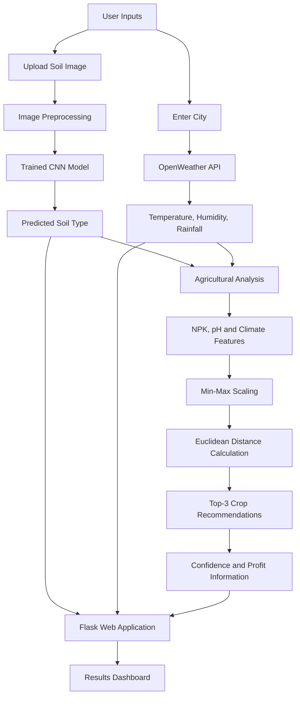

# 🌱 Smart Weather–Agro System | AI-Based Crop Recommendation

An intelligent agriculture support system that combines **Deep Learning, Machine Learning, and real-time weather data** to help farmers identify soil types and select suitable crops based on environmental conditions.

<p align="center">
  <a href="https://github.com/venkat24-dev">
    
  </a>
  
  
  
  
</p>

<p align="center">
  <a href="https://github.com/venkat24-dev/bess-deomonstartion-repo">
    <strong>💻 Explore Related Repository</strong>
  </a>
</p>

---

## 📸 Application Preview

Explore the proposed workflow of the Smart Weather–Agro System, from soil image classification and weather data acquisition to intelligent crop recommendations.

<table>
  <tr>
    <td align="center" width="50%">
      <strong>🌿 1. Soil Classification</strong><br><br>
      
      <br><sub>Upload a soil image and use a trained CNN model to identify its soil category.</sub>
    </td>
    <td align="center" width="50%">
      <strong>🌦️ 2. Weather Monitoring</strong><br><br>
      
      <br><sub>Retrieve current temperature, humidity, and rainfall information for a selected location.</sub>
    </td>
  </tr>
  <tr>
    <td align="center" width="50%">
      <strong>🌾 3. Crop Recommendation</strong><br><br>
      
      <br><sub>Rank suitable crops using agricultural nutrient data and environmental conditions.</sub>
    </td>
    <td align="center" width="50%">
      <strong>💰 4. Profitability Analysis</strong><br><br>
      
      <br><sub>Present estimated crop profitability alongside recommendation confidence values.</sub>
    </td>
  </tr>
</table>

> **Note:** The images above are illustrative placeholders. Replace them with actual screenshots of your application before publishing the repository.

---

## 🚀 Project Overview

Farmers often face difficulties choosing suitable crops because soil characteristics, nutrient availability, and weather conditions vary across regions and seasons. Traditional crop selection may not fully account for these changing environmental factors.

The Smart Weather–Agro System addresses this challenge through an integrated, data-driven approach. It combines image-based soil classification with weather information and agricultural datasets to generate crop recommendations.

The system is designed to:

- Identify soil categories from uploaded images using a Convolutional Neural Network (CNN).
- Retrieve current weather conditions using the OpenWeather API.
- Analyze agricultural parameters such as nitrogen, phosphorus, potassium, pH, temperature, humidity, and rainfall.
- Recommend the top three suitable crops based on similarity to historical crop data.
- Display recommendation confidence values and estimated profitability.

## ✨ Key Features

| Feature | Description |
|---|---|
| 🖼️ Soil Image Classification | Uses a trained CNN to classify soil images. |
| 🌦️ Live Weather Integration | Retrieves temperature, humidity, and rainfall for a selected city. |
| 🧪 Agricultural Data Analysis | Uses NPK nutrients, pH, and climate variables for crop suitability analysis. |
| 🌾 Top-3 Crop Recommendations | Ranks candidate crops using normalized feature similarity. |
| 📊 Confidence Indicators | Displays confidence values alongside recommended crops. |
| 💰 Profitability Information | Associates recommended crops with available profit estimates. |
| 🌐 Web-Based Interface | Provides a user-facing interface for submitting inputs and viewing results. |

## 🧠 System Architecture

The system follows a pipeline that connects image processing, weather acquisition, agricultural data analysis, and web-based output presentation.



## ⚙️ Technology Stack

- **Programming Language:** Python
- **Deep Learning:** TensorFlow / Keras
- **Image Processing:** NumPy and Keras image utilities
- **Machine Learning:** Scikit-learn
- **Data Processing:** Pandas and NumPy
- **Web Framework:** Flask
- **Weather Integration:** OpenWeather API
- **Frontend:** HTML and CSS templates
- **Dataset:** Agricultural crop recommendation dataset and soil image dataset

## 🔬 Methodology

### 1. CNN-Based Soil Classification

A trained Convolutional Neural Network processes the uploaded soil image and predicts its soil category.

**Processing steps:**

1. Upload a soil image through the web interface.
2. Resize the image to 128 × 128 pixels.
3. Normalize pixel values to the range 0–1.
4. Pass the image to the trained CNN model.
5. Select the predicted class from the model output.

The application code currently supports four soil classes:

- Alluvial soil
- Black soil
- Clay soil
- Red soil

The associated research work reports **93.89% overall soil classification accuracy** for a CNN experiment using the Indian Regions Soil Image Database (IRSID). This research result should not be interpreted as a separately measured accuracy for the deployed model unless the same model and evaluation procedure are verified.

### 2. Real-Time Weather Data Acquisition

The application retrieves weather information for the city entered by the user using the OpenWeather API.

Parameters include:

- Temperature (°C)
- Relative humidity (%)
- Rainfall (mm, where available)

These parameters help characterize current environmental conditions for crop recommendation.

### 3. Crop Recommendation Using Similarity Analysis

The crop recommendation module compares a feature vector containing agricultural and weather parameters against historical crop dataset records.

The workflow includes:

1. Load the crop recommendation dataset.
2. Select nitrogen (N), phosphorus (P), potassium (K), temperature, humidity, pH, and rainfall features.
3. Normalize the feature values using Min-Max scaling.
4. Calculate Euclidean distances between the input vector and dataset records.
5. Rank the records by distance and select the three nearest crop labels.

The Euclidean distance is defined as:

\[
d(x,y)=\sqrt{\sum_{i=1}^{n}(x_i-y_i)^2}
\]

Smaller distances indicate greater similarity within the normalized feature space.

**Implementation note:** The current application code uses fixed nutrient and pH values and assigns predefined confidence values. These should not be presented as measured model probabilities without additional implementation and validation.

### 4. Crop Profitability Information

The system associates recommended crops with profitability values through a crop-to-profit mapping.

These values can help compare candidate crops, but their reliability depends on the underlying profit data. Actual profitability requires region-specific yield, cultivation costs, and market prices.

## 📂 Project Structure

A suggested repository structure for organizing the application is:

```text
smart-weather-agro-system/
│
├── app.py
├── requirements.txt
├── README.md
│
├── soil_cnn_model.h5
│
├── data/
│   └── Crop_recommendation.csv
│
├── templates/
│   ├── index.html
│   └── result.html
│
├── static/
│   ├── css/
│   ├── images/
│   └── uploads/
│
└── screenshots/
    ├── soil-classification.png
    ├── weather-monitoring.png
    └── crop-recommendations.png
```

> Adapt this structure to match your actual repository. The model file, templates, dataset, and other referenced assets must be present for the application to run.

## 🛠️ Installation and Setup

### Prerequisites

- Python 3.x
- pip
- Internet connectivity for live weather requests
- A valid OpenWeather API key
- The trained CNN model and crop dataset

### Step 1: Clone the repository

```bash
git clone <YOUR_GITHUB_REPOSITORY_URL>
cd smart-weather-agro-system
```

Replace the repository URL with your actual Smart Weather–Agro System repository.

### Step 2: Create a virtual environment

```bash
python -m venv venv
```

Activate it on Windows:

```bash
venv\Scripts\activate
```

On Linux or macOS:

```bash
source venv/bin/activate
```

### Step 3: Install dependencies

Create a `requirements.txt` file containing the dependencies used by your application, with compatible versions for your environment.

```text
Flask
pandas
numpy
tensorflow
scikit-learn
requests
Pillow
```

Install the packages:

```bash
pip install -r requirements.txt
```

### Step 4: Configure the weather API

Obtain an API key from [OpenWeather](https://openweathermap.org/api).

For a safer configuration, load the key from an environment variable rather than hardcoding it in the source code.

```python
import os

API_KEY = os.environ.get("OPENWEATHER_API_KEY")
```

Update the weather request function to use `API_KEY`, and configure the environment variable before running the application.

Never commit API keys or other credentials to a public repository.

### Step 5: Verify required files

Ensure that the following files are available at the paths expected by the application:

- `soil_cnn_model.h5`
- `data/Crop_recommendation.csv`
- `templates/index.html`
- `templates/result.html`

### Step 6: Run the application

```bash
python app.py
```

Open the local address displayed in your terminal, typically:

```text
http://127.0.0.1:5000/
```

## 📊 Expected Output

After submitting a soil image and city name, the application presents:

- Predicted soil type
- Selected city
- Current temperature
- Relative humidity
- Available rainfall information
- Three recommended crop names
- Associated confidence values
- Available crop profitability estimates

The output is intended to support preliminary agricultural decision-making. Crop recommendations should be validated against local soil tests, seasonal conditions, irrigation availability, and guidance from agricultural experts.

## 📈 Research and Evaluation

The accompanying research paper on CNN-based soil classification reports the following experimental result:

| Metric | Reported result |
|---|---:|
| Soil classification accuracy | 93.89% |
| Soil image input size | 128 × 128 pixels |
| Optimizer | Adam |
| Learning rate | 0.001 |
| Training epochs | 100 |
| Batch size | 2 |

These values describe the reported IRSID soil-classification experiment, not a complete evaluation of every component of the integrated web application.

The broader crop recommendation research discusses classification metrics such as accuracy, precision, recall, and F1-score. Separate evaluation is needed to establish the deployed crop recommendation module's performance.

## 🌍 Applications

- Precision agriculture and crop planning
- Preliminary soil identification
- Weather-aware agricultural decision support
- Educational demonstrations of AI in agriculture
- Research into intelligent farming systems
- Future integration with IoT-based soil and weather sensors

## ⚠️ Limitations

- Visual soil classification cannot replace laboratory soil testing.
- The current implementation uses fixed NPK and pH values rather than measured soil nutrient values.
- Weather information depends on API availability and data coverage.
- The recommendation algorithm uses feature similarity rather than a fully trained predictive ensemble in the current application code.
- Confidence values and profitability estimates require further validation.
- The current implementation does not establish that the predicted soil class directly changes the numerical nutrient values used for crop ranking.

## 🔮 Future Enhancements

- Integrate IoT sensors for real-time soil moisture, pH, and nutrient measurements.
- Implement and validate a Random Forest and Gradient Boosting ensemble for crop prediction.
- Incorporate verified market prices, cultivation costs, and regional yield estimates.
- Add weather forecasts and rainfall alerts.
- Expand soil image datasets with diverse regional samples.
- Support regional languages and location-specific crop recommendations.
- Develop a mobile-friendly dashboard and deploy the application to a production environment.

## 👥 Project Team

**Batch 11 — Smart Weather–Agro System**

- Adapa Nishitha
- Pindi Venkata Nageswara Rao
- Chokkapu Rohith

**Faculty Advisor:** Mrs. Pagadala Usha

Department of Electronics and Communication Engineering  
National Institute of Technology Andhra Pradesh, India

## 📚 References

1. P. Usha and S. K. Puli, “CNN-Based Soil Classification for Enhanced Telugu Agriculture,” *2024 Asian Conference on Intelligent Technologies (ACOIT)*, 2024. DOI: [10.1109/ACOIT62457.2024.10939533](https://doi.org/10.1109/ACOIT62457.2024.10939533).
2. H. Afzal et al., “Incorporating soil information with machine learning for crop recommendation to improve agricultural output,” *Scientific Reports*, vol. 12, 2022.
3. A. Ghosh et al., “A comprehensive crop recommendation system integrating machine learning and deep learning models,” *IEEE Access*, vol. 9, 2021.
4. [OpenWeather API Documentation](https://openweathermap.org/api).
5. [Scikit-learn Documentation](https://scikit-learn.org/stable/).

---

<p align="center">
  <strong>🌱 Smart Farming. Smarter Decisions. Sustainable Agriculture.</strong>
</p>
